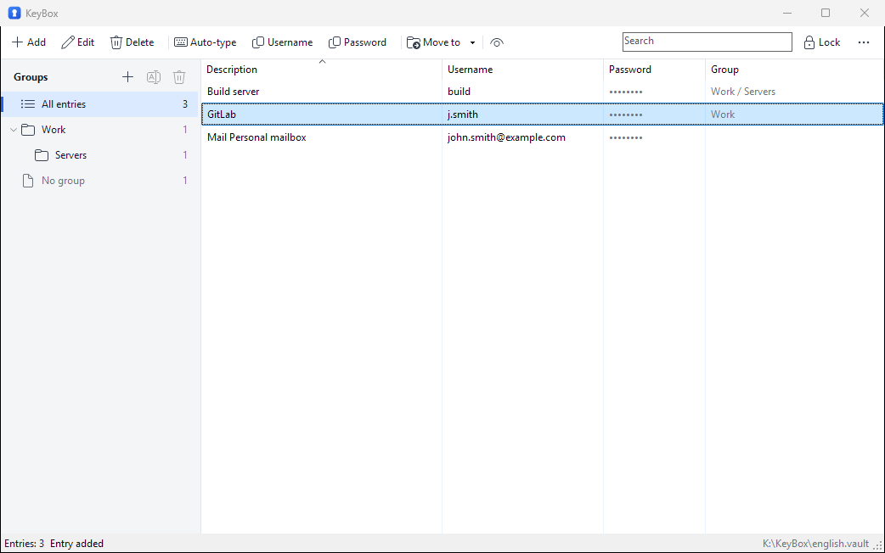
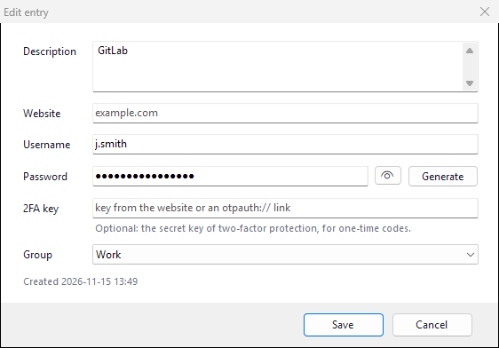
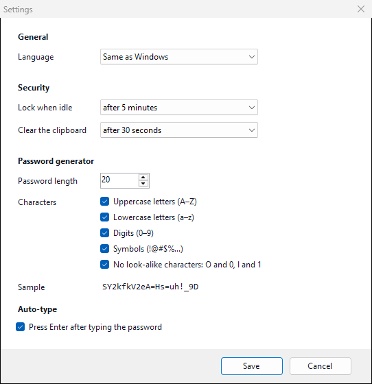
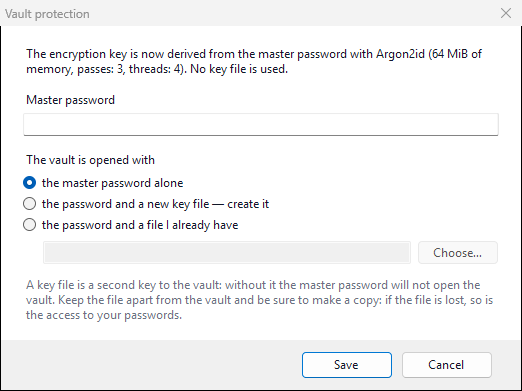

# KeyBox

A portable encrypted password vault for Windows. · [Русский](README.md)

One program file (`KeyBox.exe`, about 340 KB) and one data file next to it
(`keybox.vault`). Nothing is installed and nothing is written to the registry or to the
user profile — carry the folder on a USB stick and run it on any computer with Windows 10,
Windows 11 or Windows Server.

The interface is available in English and Russian; the language follows Windows and can
be changed in the settings.



## Features

- **Master password sign-in.** The first start creates a vault; after that the program
  asks for the master password every time. A key file can serve as a second key.
- **Entries:** description, username, password, website address and a one-time code key
  (2FA). The description may have several lines. The website opens in the browser, and
  the code is shown and copied right in the program.
- **Groups:** create, rename, delete. Groups can be nested (up to 8 levels). Every entry
  can be given a group; entries without one are collected under “No group”.
- **Moving between groups** in three ways: drag entries onto a group, use the “Move to”
  button (or the same item of the context menu), or pick a group in the entry window.
  Several selected entries can be moved at once. Groups themselves can be moved too —
  by dragging or in the group window.
- Search by description, username, website address and group name.
- **Auto-type:** the program types the username and password into the window that was
  active before it — a browser or any other program.
- Copying the username, password and one-time code to the clipboard, which is cleared
  automatically after 30 seconds.
- Random password generator with adjustable length and character set.
- **Trash and previous passwords.** A deleted entry stays in the trash for 30 days and
  can be restored from there. Every entry keeps up to 10 of its previous passwords.
- **Import and export.** Passwords are brought over from browsers (Chrome, Edge, Firefox)
  and other password managers (Bitwarden, KeePassXC) through a CSV file; export goes
  to CSV or JSON.
- **Several computers.** The vault file can live in a shared or cloud folder: changes made
  on different computers are merged instead of overwriting each other.
- Locking by hand, after 5 minutes of inactivity and when Windows is locked.
- Changing the master password.
- Settings: language (English or Russian), time before locking and before the clipboard
  is cleared, password generator. They are stored in the vault itself and travel with it.
- Every change is encrypted and written to the file at once; the previous version of the
  file is kept next to it as a backup.

| Entry | Settings | Vault protection |
| --- | --- | --- |
|  |  |  |

## Quick start

1. Download the ready-made `KeyBox.exe` from the [releases](https://github.com/ihate7/key-box/releases/latest)
   page or build it yourself: run `build.cmd` and `dist\KeyBox.exe` appears.
   The build uses the C# compiler that is part of Windows; there is nothing to install
   or download for it.
2. Copy `KeyBox.exe` to where the vault is going to live: a USB stick, a folder on a disk.
3. Start the program and choose a master password. A file named `keybox.vault` appears
   next to the program — that is the vault.

To move the passwords to another computer or drive, copy `KeyBox.exe` and `keybox.vault`.

To bring passwords over from a browser, export them to a CSV file (“Export passwords” in
the password settings of Chrome, Edge and Firefox) and choose “⋯ → Import from a CSV file…”
in KeyBox. The entries go into a new group of their own. Delete the file afterwards: the
passwords in it are in plain text.

> **The master password cannot be recovered.** It is not stored anywhere, and without it
> nobody can open the vault. Remember it, and copy the `keybox.vault` file somewhere safe
> from time to time.

## Using the program

The group tree is on the left; on the right are the entries of the selected group, without
its subgroups (“All entries” shows everything at once). Click a column header to sort.
Double-click an entry to open it.

A new group is created inside the selected one; the group window lets you choose another
place or the top level. A branch is collapsed with the arrow to the left of its name.

| Keys | Action |
| --- | --- |
| `Ins`, `Ctrl+N` | new entry |
| `Enter`, `F2` | edit the entry |
| `Del` | move the selected entries to the trash (in the group tree: delete the group) |
| `Ctrl+T` | auto-type the username and password |
| `Ctrl+Shift+T` | auto-type the password only |
| `Ctrl+C` | copy the password |
| `Ctrl+B` | copy the username |
| `Ctrl+Shift+C` | copy the one-time code |
| `Ctrl+U` | open the website of the entry in the browser |
| `Ctrl+F` | search, `Esc` clears it |
| `Ctrl+H` | show or hide passwords in the list |
| `Ctrl+G` | new group |
| `F2` in the group tree | edit the group: name and place |
| `←`, `→` in the group tree | collapse and expand a branch |
| `Ctrl+L` | lock the vault |
| `Ctrl+Enter` in the entry window | save the entry |

**Auto-type.** Click the username field on a website or in a program, switch to KeyBox,
select an entry and press “Auto-type”. KeyBox minimises itself and types the username,
`Tab` and the password into that window; whether `Enter` is pressed at the end is set in
the settings. If another window becomes active in the meantime, typing stops.

**Trash.** Deleted entries go to the trash, which is visible in the group tree while there
is something in it. From there an entry can be put back or erased for good; after 30 days
entries are erased automatically. The previous passwords of an entry are in its context menu.

Deleting a group deletes its subgroups as well, but the entries stay: they move one level
up — to the parent group or, if there is none, to “No group”.
Settings, changing the master password, vault protection (key file), import, export,
merging with another file and the About box are in the “⋯” menu on the right of the toolbar.

## Files and portability

| File | What it is |
| --- | --- |
| `KeyBox.exe` | the program |
| `keybox.vault` | the vault (encrypted) |
| `keybox.vault.bak` | the previously saved version of the vault (encrypted) |
| a key file, for example `keybox.key` | the second key, if you turned it on; it lies where you saved it |

- By default the vault lies in the program folder. Another file can be given as an argument:
  `KeyBox.exe "E:\Secrets\work.vault"` — this is how to keep several vaults.
  The key file can be given at start too, so that it need not be chosen in the sign-in window:
  `KeyBox.exe --key "F:\keybox.key"`.
- The program needs .NET Framework 4.8. It is part of Windows 10 (version 1903 and later),
  Windows 11 and Windows Server 2022 and 2025 — nothing has to be installed there. On
  Windows Server 2019 and 2016 it has to be installed separately (free, from Microsoft).
- The same file runs on 32-bit and 64-bit Windows, including computers with ARM processors.
  A server needs the installation with a desktop (Desktop Experience).
- Data is written through a temporary file and verified, so a USB stick pulled out at
  a bad moment does not damage the vault. If the main file is lost or damaged after all,
  the program offers the backup (or rename `keybox.vault.bak` to `keybox.vault`).
- **Shared or cloud folder.** One vault file can be opened from several computers, even
  at the same time. Before every write and once every few seconds the program compares
  itself with the file and merges the changes made elsewhere: new entries appear, deleted
  ones disappear. If one entry was changed in two places, the later edit stays and the
  password of the other one goes to the previous passwords of the entry. “Later” is
  decided by the clocks of the computers, so they have to be right.
- A copy of the vault from another drive, or a “conflicted copy” created by a cloud folder,
  can be merged in with “⋯ → Merge with a file…”. If the copy has a different master
  password, the program asks for it.
- If the master password was changed on another computer, the program that is open here
  does not overwrite the file: it sets the unsaved changes aside in a file named
  `keybox.conflict-date-time.vault` next to it (it opens with the previous password)
  and locks itself.
- On one computer a vault is opened by one copy of the program: starting it again simply
  shows the window that is already open.
- The program file is not digitally signed. If it is passed around over the internet,
  Windows may show a SmartScreen warning.

## Security

- The encryption key is derived from the master password with **Argon2id** (64 MiB of
  memory, 3 passes, 4 threads — parameters from RFC 9106; a random 32-byte salt). On an
  ordinary computer that is a fraction of a second per sign-in attempt. Every attempt
  needs its own 64 MiB of memory, which holds back guessing on graphics cards — by how
  much, see below.
- Vaults created by KeyBox 1.x open as before (PBKDF2-HMAC-SHA512, 600,000 iterations)
  and move to Argon2id when the master password is changed or in the “Vault protection”
  window.
- **A key file** is an optional second key: 64 random bytes that the program creates
  (any file of yours will do as well). With it the vault opens only with the password
  and the file together. Keep the file apart from the vault and make a copy of it:
  without it nobody can open the vault.
- The data is encrypted with **AES-256-GCM**. The cipher also verifies integrity: any
  change to the file, the header included, is detected when it is opened. Every save
  uses a fresh random nonce.
- AES-GCM and PBKDF2 come from Windows itself (CNG, `bcrypt.dll`); SHA-2, HMAC and the
  random number generator come from the .NET Framework that is part of it.
  Windows has no Argon2id, so it is implemented in the program
  (together with BLAKE2b) — `src/Crypto/Argon2.cs` — and checked against the test vector
  of RFC 9106 and against an independent implementation (OpenSSL as shipped with Node.js)
  in both directions. The program uses no third-party libraries.
- Only the encrypted file is written to disk; neither the plain data nor the master
  password ever get there. The master password is not kept in memory either — only the
  key derived from it, which is wiped on locking. The exception is export: an exported
  file is not encrypted, and the program warns about it.
- A copied password is marked so that it stays out of the clipboard history (Win+V) and
  out of cloud synchronisation; it is erased after 30 seconds and when the program exits.
- After the master password is changed the backup is re-encrypted too: the old password
  no longer opens anything.

What the program cannot do:

- It does not protect against malware on the computer where you type the master password
  (keyboard and clipboard capture, memory reading). Keep that in mind on other people's
  computers.
- The strength of the vault is the strength of the master password. A short or dictionary
  password can be guessed; a phrase of several words is the safest. For scale: published
  measurements (hashcat 7) put a powerful graphics card at about a thousand guesses per
  second, and several times more for vaults of the old format. One such card goes through
  eight random lowercase letters in a few years, a hundred cards in a few weeks; a phrase
  of five random words would take the same hundred cards millions of years. A key file
  settles the matter: without the file itself, guessing the password is pointless.
- While the vault is open, the decrypted entries are in the memory of the process.
  In the managed .NET environment strings cannot be reliably erased at once.
- The Argon2id implementation is the program's own. It is checked against the reference
  values but has not been independently audited.
- The one-time code key lies in the same vault as the password. That is convenient, but
  the second factor stops being independent of the first: whoever opens the vault has both.

The time before auto-lock, the lifetime of the clipboard and the password generator are
adjusted in the settings window. The key derivation parameters are constants in
`src/Vault/VaultFormat.cs` and `src/Crypto/Argon2.cs`.

Found a vulnerability? [SECURITY.md](SECURITY.md) explains how to report it (the text is
in Russian; reports in English are welcome).

## Vault file format

The format is deliberately simple and open: a vault can be decrypted with standard tools
without this program — see `tests/interop.js` (about 250 lines of Node.js).

All numbers are little-endian.

| Offset | Size | Field |
| --- | --- | --- |
| 0 | 6 | signature `KEYBOX` (ASCII) |
| 6 | 2 | format version = 2 |
| 8 | 1 | key derivation function: 1 = PBKDF2-HMAC-SHA512, 2 = Argon2id |
| 9 | 1 | cipher: 1 = AES-256-GCM |
| 10 | 1 | flags: bit 0 — a key file is required |
| 11 | 1 | reserved = 0 |
| 12 | 4 | number of Argon2id passes (or PBKDF2 iterations) |
| 16 | 4 | Argon2id memory in KiB (0 for PBKDF2) |
| 20 | 4 | number of Argon2id threads (0 for PBKDF2) |
| 24 | 32 | salt |
| 56 | 12 | nonce |
| 68 | N | ciphertext |
| 68+N | 16 | GCM authentication tag |

- The secret is the master password in UTF-8 (normalised to Unicode form NFC first).
  With a key file the secret is HMAC-SHA512 of the password keyed with SHA-512(file contents).
- The key is 32 bytes: Argon2id version 1.3 (or PBKDF2-HMAC-SHA512) of the secret and the salt.
- The header (the first 68 bytes) is passed to GCM as additional authenticated data.
- Vaults of KeyBox 1.x are written in format version 1, which has a shorter header
  (58 bytes): the cipher field is followed directly by the number of PBKDF2 iterations
  (4 bytes), the salt and the nonce. The program reads both formats and keeps writing the
  old one until the password or the protection of the vault is changed.
- The plaintext is JSON in UTF-8:

```json
{
  "version": 3,
  "groups": [
    { "id": "…", "name": "Work" },
    { "id": "…", "name": "Projects", "parentId": "…" }
  ],
  "entries": [
    {
      "id": "…",
      "groupId": "…",
      "login": "user@example.com",
      "password": "…",
      "description": "Mail",
      "created": "2026-11-14T12:00:00Z",
      "modified": "2026-11-15T09:30:00Z",
      "url": "mail.example.com",
      "totp": "JBSWY3DPEHPK3PXP",
      "history": [
        { "password": "…", "replaced": "2026-11-15T09:30:00Z" }
      ]
    }
  ],
  "settings": { "language": "en", "autoLockMinutes": 5, "clipboardSeconds": 30, "…": "…" }
}
```

`groupId` is `null` for entries without a group. The `parentId` field exists only for
nested groups and points to the parent. An entry in the trash has a `deleted` field — the
time of deletion. `version` is the lowest version that is enough for the contents:
1 — no nested groups, 2 — with them, 3 — if there are website addresses, code keys,
previous passwords, a trash or settings. A vault of version 1 or 2 can still be opened
by KeyBox 1.x.

For merging copies, entries, groups and settings carry a service field `changed` (the
time of the last change), and the `removed` list remembers what was erased for good.

## Project layout

```
build.cmd                 builds dist\KeyBox.exe
KeyBox.csproj             project for Visual Studio and Rider (code hints, debugging)
src\
  Program.cs              start-up, the “sign in → work → lock” loop
  L.cs                    two interface languages: every text is given in Russian and English
  SingleInstance.cs       guards against a second copy for the same vault
  NativeMethods.cs        Win32 calls
  Crypto\                 PBKDF2 and AES-GCM through Windows CNG, Argon2id, one-time codes,
                          password generator
  Vault\                  file format, safe writing, data model and merging of copies,
                          import and export
  UI\                     windows: sign-in, main window, entry, group, settings, protection,
                          previous passwords, dialogs; auto-type
res\                      icon, logo, application manifest
tools\make-icon.ps1       icon generator (needed only to change the picture)
tests\                    tests
docs\                     screenshots for this file
.github\workflows\        automatic test runs on GitHub
```

The code is written in C# 5 — the language version understood by the compiler that comes
with Windows. The interface is built with Windows Forms. Comments in the sources are in
Russian. For editing and debugging it is convenient to open `KeyBox.csproj` in Visual
Studio or Rider; the file to carry around is still built by `build.cmd`.

## Tests

```
tests\run-tests.cmd
```

- **Core** (`tests\CoreTests.cs`): known-answer vectors for PBKDF2, AES-GCM (NIST), BLAKE2b,
  Argon2id (RFC 9106) and one-time codes (RFC 6238); detection of any changed bit of the
  file, truncated and foreign files, a wrong password, the key file, changing the password,
  the backup, no plain data on disk; all operations on groups and entries, the trash,
  previous passwords; import of browser and password manager files; merging of copies —
  including a check on random edits that two copies always converge to the same contents.
- **Format compatibility** (`tests\interop.js`, if Node.js is installed): an independent
  implementation writes a vault that KeyBox opens, and opens a vault written by KeyBox.
  Format version 2 is cross-checked if Node.js has Argon2 (version 24.7 and later).
- **Interface** (`tests\UiTests.cs`): the test starts the real windows of the program and
  walks the whole path of a user — creating a vault, groups (nested ones too), entries,
  moving by menu and by drag and drop, search, sorting, the trash, previous passwords,
  settings, auto-type, import and export, a failed write to disk, locking, signing in,
  changing the master password, the key file, two copies working with one file,
  auto-lock — and the same in English. The windows open beyond the edge of the screen
  and do not get in the way. The clipboard is checked in a separate invisible Windows
  session with a clipboard of its own, so the test does not touch yours; it presses
  no keys on your desktop either.

Also: `tests\run-tests.cmd core` runs the core only; `tests\run-tests.cmd visible` shows
the windows on the screen. `tests\out\UiTests.exe tests\out\ui --scale 1.5` checks the
layout of the windows for a display scale of 150 % (likewise 1.25, 1.75, 2), and the
`--no-icons` switch checks a system that lacks the icon font.

The same tests run automatically on GitHub on every change — on Windows Server 2022,
Windows Server 2025 and Windows 11 for ARM (`.github/workflows/tests.yml`). There
auto-type is also checked with real keystrokes sent to a test window.

## Limitations

- Windows only: there are no versions for macOS, Linux or phones.
- No browser extension: instead of autofill there are auto-type and copying.
- Merging copies is not a synchronisation server: it works where the file itself gets to
  (a shared or cloud folder, a USB stick) and relies on the clocks of the computers.
  It is tested with two copies of the program on one file, not with every cloud service
  individually, and it is no substitute for backups.
- Import reads CSV files only.

## License

[MIT](LICENSE).
