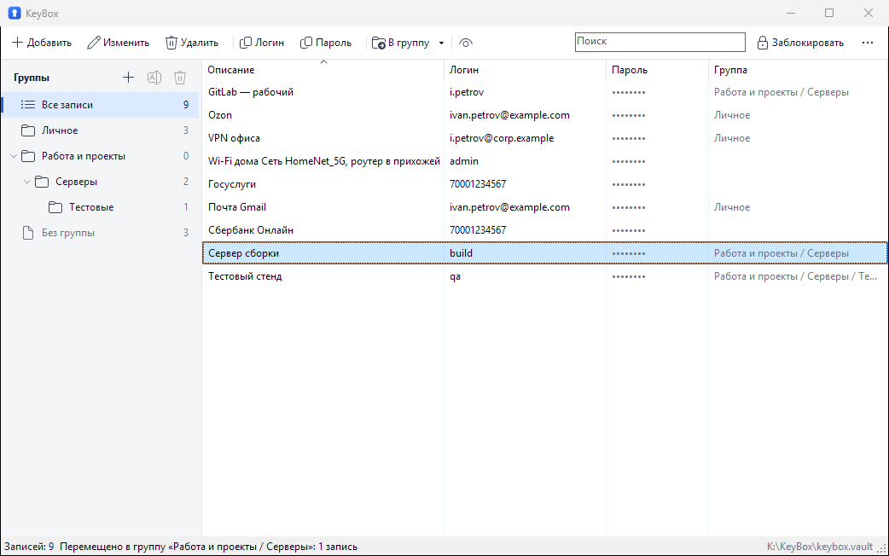
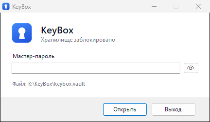
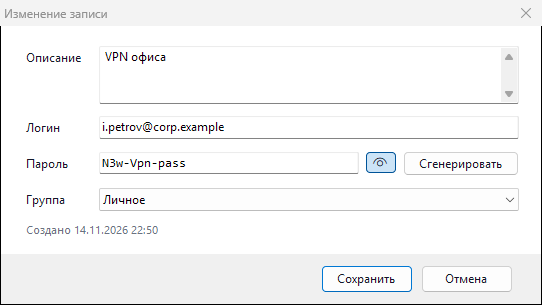
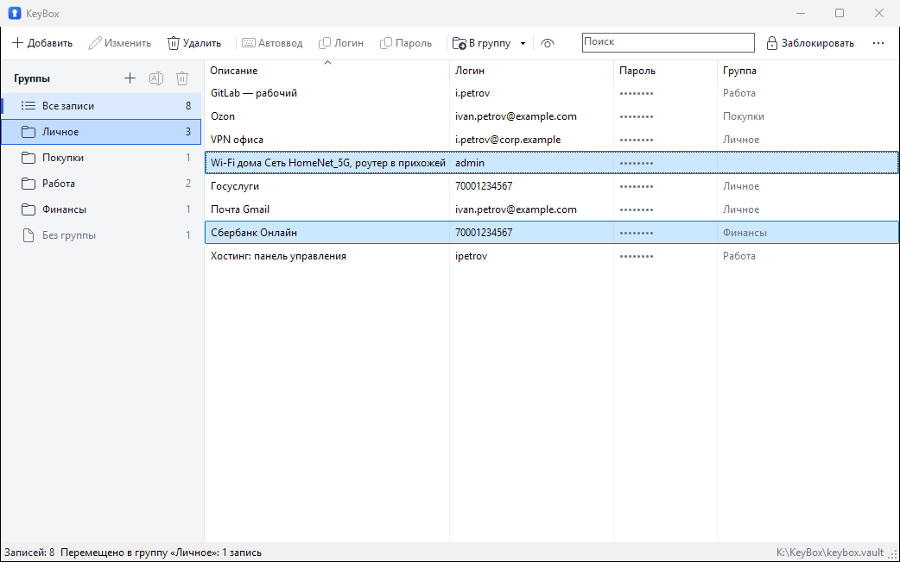

# KeyBox

Портативное зашифрованное хранилище паролей для Windows.

Один файл программы (`KeyBox.exe`, около 230 КБ) и один файл данных рядом с ним
(`keybox.vault`). Ничего не устанавливается, в реестр и в профиль пользователя ничего
не пишется — папку можно носить на флешке и запускать на любом компьютере с Windows 10,
Windows 11 или Windows Server.



## Возможности

- **Вход по мастер-паролю.** При первом запуске создаётся хранилище, дальше программа
  каждый раз спрашивает мастер-пароль.
- **Записи:** описание, логин, пароль. Описание может быть многострочным.
- **Группы:** создание, переименование, удаление. Группы можно вкладывать друг в друга
  (до 8 уровней). У каждой записи можно выбрать группу; записи без группы собраны
  в разделе «Без группы».
- **Перемещение между группами** тремя способами: перетаскиванием на группу, кнопкой
  «В группу» (или тем же пунктом контекстного меню) и выбором группы в окне записи.
  Можно перемещать сразу несколько выделенных записей. Сами группы тоже переносятся —
  перетаскиванием или в окне группы.
- Поиск по описанию, логину и названию группы.
- Копирование логина и пароля в буфер обмена с автоматической очисткой через 30 секунд.
- Генератор случайных паролей (20 символов).
- Блокировка вручную, через 5 минут бездействия и при блокировке Windows.
- Смена мастер-пароля.
- Каждое изменение сразу шифруется и записывается в файл; предыдущая версия файла
  сохраняется рядом как резервная копия.

| Вход | Запись | Перетаскивание в группу |
| --- | --- | --- |
|  |  |  |

## Быстрый старт

1. Скачайте готовый `KeyBox.exe` со страницы [выпусков](https://github.com/ihate7/key-box/releases/latest)
   или соберите его сами: запустите `build.cmd` — появится `dist\KeyBox.exe`.
   Сборка использует компилятор C#, который входит в состав Windows; ничего
   устанавливать и скачивать для неё не нужно.
2. Скопируйте `KeyBox.exe` туда, где будет жить хранилище: на флешку, в папку на диске.
3. Запустите программу и придумайте мастер-пароль. Рядом с программой появится файл
   `keybox.vault` — это и есть хранилище.

Чтобы перенести пароли на другой компьютер или носитель, достаточно скопировать
`KeyBox.exe` и `keybox.vault`.

> **Мастер-пароль нельзя восстановить.** Он нигде не хранится, и без него хранилище
> не откроет никто. Запомните его и время от времени делайте копию файла `keybox.vault`.

## Работа с программой

Слева — дерево групп, справа — записи выбранной группы без её подгрупп («Все записи»
показывает всё сразу). Столбцы сортируются щелчком по заголовку. Двойной щелчок по записи
открывает её.

Новая группа создаётся внутри выбранной; в окне группы можно указать другое место или
верхний уровень. Ветка сворачивается стрелкой слева от названия.

| Клавиши | Действие |
| --- | --- |
| `Ins`, `Ctrl+N` | новая запись |
| `Enter`, `F2` | изменить запись |
| `Del` | удалить выбранные записи (в дереве групп — группу) |
| `Ctrl+C` | копировать пароль |
| `Ctrl+B` | копировать логин |
| `Ctrl+F` | поиск, `Esc` — сбросить |
| `Ctrl+H` | показать или скрыть пароли в списке |
| `Ctrl+G` | новая группа |
| `F2` в дереве групп | изменить группу: название и расположение |
| `←`, `→` в дереве групп | свернуть и раскрыть ветку |
| `Ctrl+L` | заблокировать хранилище |
| `Ctrl+Enter` в окне записи | сохранить запись |

При удалении группы удаляются и её подгруппы, а записи остаются: они переходят на уровень
выше — в родительскую группу или, если её нет, в «Без группы».
Смена мастер-пароля и сведения о программе — в меню «⋯» справа на панели.

## Файлы и переносимость

| Файл | Что это |
| --- | --- |
| `KeyBox.exe` | программа |
| `keybox.vault` | хранилище (зашифровано) |
| `keybox.vault.bak` | предыдущая сохранённая версия хранилища (зашифрована) |

- Хранилище по умолчанию лежит в папке программы. Другой файл можно указать аргументом:
  `KeyBox.exe "E:\Секреты\рабочее.vault"` — так можно держать несколько хранилищ.
- Программе нужен .NET Framework 4.8. Он входит в состав Windows 10 (начиная с версии 1903),
  Windows 11 и Windows Server 2022 и 2025 — там ничего ставить не нужно. На Windows Server 2019
  и 2016 его нужно установить отдельно (бесплатно, с сайта Microsoft).
- Один и тот же файл работает и в 32-, и в 64-разрядной Windows, в том числе на компьютерах
  с процессорами ARM. На сервере нужна установка с рабочим столом (Desktop Experience).
- Запись на носитель идёт через временный файл с проверкой, поэтому выдернутая в неудачный
  момент флешка не испортит хранилище. Если основной файл всё же пропал или повреждён,
  программа предложит резервную копию (или переименуйте `keybox.vault.bak` в `keybox.vault`).
- Одно хранилище нельзя открыть в двух копиях программы сразу: повторный запуск просто
  показывает уже открытое окно.
- Файл программы не имеет цифровой подписи. Если передавать его через интернет,
  Windows может показать предупреждение SmartScreen.

## Безопасность

- Ключ шифрования получается из мастер-пароля функцией **PBKDF2-HMAC-SHA512**
  (600 000 итераций, случайная соль 32 байта). На обычном компьютере это около половины
  секунды на одну попытку входа. Подбор на видеокартах идёт быстрее — см. ниже.
- Данные шифруются **AES-256-GCM**. Шифр заодно проверяет целостность: любое изменение
  файла, включая заголовок, обнаруживается при открытии. При каждом сохранении
  используется новый случайный nonce.
- Используются только криптографические функции самой Windows (CNG, `bcrypt.dll`).
  В программе нет сторонних библиотек и собственных реализаций алгоритмов.
- На диск пишется только зашифрованный файл; открытые данные и мастер-пароль на диск
  не попадают. Мастер-пароль не хранится и в памяти — только полученный из него ключ,
  который затирается при блокировке.
- Скопированный пароль помечается так, чтобы не попадать в журнал буфера обмена (Win+V)
  и в облачную синхронизацию, и стирается через 30 секунд, а также при выходе из программы.
- После смены мастер-пароля резервная копия тоже перешифровывается: старый пароль
  больше ничего не открывает.

Чего программа не может:

- Она не защитит от вредоносных программ на том компьютере, где вы вводите мастер-пароль
  (перехват клавиатуры, чтение памяти). На чужих компьютерах об этом стоит помнить.
- Стойкость хранилища определяется мастер-паролем. Короткий или словарный пароль
  подбирается; надёжнее всего фраза из нескольких слов. Для ориентира: одна мощная
  видеокарта проверяет несколько тысяч вариантов в секунду. Восемь случайных строчных
  букв так подбираются за несколько месяцев, а фраза из пяти случайных слов — за миллионы лет.
- Пока хранилище открыто, расшифрованные записи находятся в памяти процесса.
  В управляемой среде .NET строки нельзя гарантированно стереть сразу.
- PBKDF2 уступает Argon2 в стойкости к подбору на видеокартах. Он выбран потому, что
  реализован в самой Windows и не требует стороннего кода.

Числовые параметры (время до автоблокировки, время жизни буфера обмена, число итераций)
заданы константами в `src/UI/MainForm.cs` и `src/Vault/VaultFormat.cs`.

Нашли уязвимость? Как о ней сообщить — в [SECURITY.md](SECURITY.md).

## Формат файла хранилища

Формат намеренно простой и открытый: хранилище можно расшифровать стандартными
средствами и без этой программы — см. `tests/interop.js` (около ста строк на Node.js).

Все числа — little-endian.

| Смещение | Размер | Поле |
| --- | --- | --- |
| 0 | 6 | сигнатура `KEYBOX` (ASCII) |
| 6 | 2 | версия формата = 1 |
| 8 | 1 | функция получения ключа: 1 = PBKDF2-HMAC-SHA512 |
| 9 | 1 | шифр: 1 = AES-256-GCM |
| 10 | 4 | число итераций PBKDF2 |
| 14 | 32 | соль |
| 46 | 12 | nonce |
| 58 | N | шифртекст |
| 58+N | 16 | тег аутентификации GCM |

- Ключ: PBKDF2-HMAC-SHA512 от мастер-пароля в UTF-8 (предварительно приведённого
  к форме Юникода NFC), 32 байта.
- Первые 58 байт (заголовок) передаются в GCM как дополнительные аутентифицируемые данные.
- Открытый текст — JSON в UTF-8:

```json
{
  "version": 2,
  "groups": [
    { "id": "…", "name": "Работа" },
    { "id": "…", "name": "Проекты", "parentId": "…" }
  ],
  "entries": [
    {
      "id": "…",
      "groupId": "…",
      "login": "user@example.com",
      "password": "…",
      "description": "Почта",
      "created": "2026-11-14T12:00:00Z",
      "modified": "2026-11-14T12:00:00Z"
    }
  ]
}
```

`groupId` равен `null` у записей без группы. Поле `parentId` есть только у вложенных групп
и указывает на родительскую. `version` равно 2, если в хранилище есть вложенные группы,
и 1, если их нет: такое хранилище по-прежнему открывает и KeyBox 1.0.

## Устройство проекта

```
build.cmd                 сборка dist\KeyBox.exe
KeyBox.csproj             проект для Visual Studio и Rider (подсказки по коду, отладка)
src\
  Program.cs              запуск, цикл «вход → работа → блокировка»
  SingleInstance.cs       защита от второй копии для того же хранилища
  NativeMethods.cs        вызовы Win32
  Crypto\                 PBKDF2 и AES-GCM через Windows CNG, генератор паролей
  Vault\                  формат файла, надёжная запись, модель данных (группы и записи)
  UI\                     окна: вход, главное окно, запись, группа, смена пароля, диалоги
res\                      значок, логотип, манифест приложения
tools\make-icon.ps1       генератор значка (нужен, только чтобы изменить рисунок)
tests\                    тесты
docs\                     снимки экрана для этого файла
.github\workflows\        автоматический запуск тестов на GitHub
```

Код написан на C# 5 — это версия языка, которую понимает компилятор из состава Windows.
Интерфейс собран на Windows Forms. Для правки и отладки удобно открыть `KeyBox.csproj`
в Visual Studio или Rider; итоговый файл для переноса по-прежнему собирает `build.cmd`.

## Тесты

```
tests\run-tests.cmd
```

- **Ядро** (`tests\CoreTests.cs`): эталонные векторы PBKDF2 и AES-GCM (NIST), обнаружение
  изменения любого бита файла, усечённые и чужие файлы, неверный пароль, смена пароля,
  резервная копия, отсутствие открытых данных на диске, все операции с группами и записями.
- **Совместимость формата** (`tests\interop.js`, если установлен Node.js): независимая
  реализация записывает хранилище, которое открывает KeyBox, и открывает хранилище,
  записанное KeyBox.
- **Интерфейс** (`tests\UiTests.cs`): тест запускает настоящие окна программы и проходит
  весь путь пользователя — создание хранилища, группы (в том числе вложенные), записи,
  перемещение меню и перетаскиванием, поиск, сортировка, удаление, сбой записи на диск,
  блокировка, вход, смена мастер-пароля, автоблокировка. Окна при этом открываются
  за краем экрана и не мешают работе. Проверка буфера обмена идёт в отдельном невидимом
  сеансе Windows со своим буфером, так что ваш буфер обмена тест не трогает.

Дополнительно: `tests\run-tests.cmd core` — только ядро; `tests\run-tests.cmd visible` —
окна показываются на экране. Запуск `tests\out\UiTests.exe tests\out\ui --scale 1.5`
проверяет раскладку окон для масштаба экрана 150 % (так же — 1.25, 1.75, 2), а ключ
`--no-icons` — работу в системе, где нет шрифта со значками.

Эти же тесты автоматически запускаются на GitHub при каждом изменении — на Windows Server 2022,
Windows Server 2025 и Windows 11 для ARM (`.github/workflows/tests.yml`).

## Ограничения

- Только Windows: версий для macOS и Linux нет.
- Нет синхронизации и слияния: если один и тот же файл хранилища менять на двух
  компьютерах по отдельности, останется та версия, которую скопируют последней.
- Нет импорта и экспорта в другие форматы.

## Лицензия

[MIT](LICENSE).
