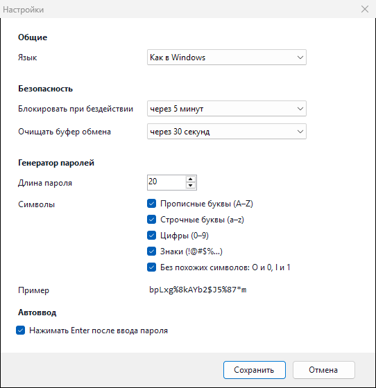
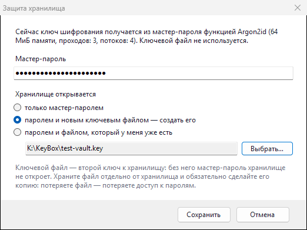
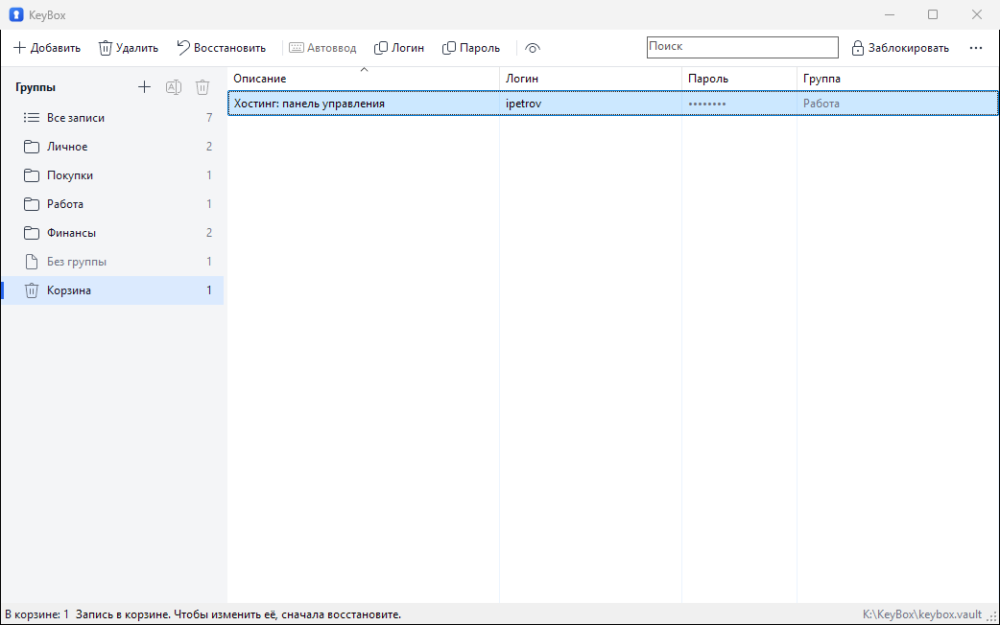

# KeyBox

Портативное зашифрованное хранилище паролей для Windows. · [English](README.en.md)

Один файл программы (`KeyBox.exe`, около 340 КБ) и один файл данных рядом с ним
(`keybox.vault`). Ничего не устанавливается, в реестр и в профиль пользователя ничего
не пишется — папку можно носить на флешке и запускать на любом компьютере с Windows 10,
Windows 11 или Windows Server.


## Возможности

- **Вход по мастер-паролю.** При первом запуске создаётся хранилище, дальше программа
  каждый раз спрашивает мастер-пароль. Вторым ключом может служить ключевой файл.
- **Записи:** описание, логин, пароль, адрес сайта и ключ одноразовых кодов (2FA).
  Описание может быть многострочным. Сайт открывается в браузере, код показывается
  и копируется прямо из программы.
- **Группы:** создание, переименование, удаление. Группы можно вкладывать друг в друга
  (до 8 уровней). У каждой записи можно выбрать группу; записи без группы собраны
  в разделе «Без группы».
- **Перемещение между группами** тремя способами: перетаскиванием на группу, кнопкой
  «В группу» (или тем же пунктом контекстного меню) и выбором группы в окне записи.
  Можно перемещать сразу несколько выделенных записей. Сами группы тоже переносятся —
  перетаскиванием или в окне группы.
- Поиск по описанию, логину, адресу сайта и названию группы.
- **Автоввод:** программа сама набирает логин и пароль в окне, которое было активно
  до неё, — в браузере или в любой другой программе.
- Копирование логина, пароля и одноразового кода в буфер обмена с автоматической
  очисткой через 30 секунд.
- Генератор случайных паролей: длина и набор символов настраиваются.
- **Корзина и прежние пароли.** Удалённая запись 30 дней лежит в корзине, откуда её можно
  вернуть. У каждой записи хранится до 10 её прежних паролей.
- **Импорт и экспорт.** Пароли переносятся из браузеров (Chrome, Edge, Firefox) и других
  менеджеров паролей (Bitwarden, KeePassXC) через файл CSV; экспорт — в CSV или JSON.
- **Несколько компьютеров.** Файл хранилища можно держать в общей или облачной папке:
  изменения, сделанные на разных компьютерах, объединяются, а не затирают друг друга.
- Блокировка вручную, через 5 минут бездействия и при блокировке Windows.
- Смена мастер-пароля.
- Настройки: язык (русский или английский), время до блокировки и до очистки буфера
  обмена, генератор паролей. Они хранятся в самом хранилище и переезжают вместе с ним.
- Каждое изменение сразу шифруется и записывается в файл; предыдущая версия файла
  сохраняется рядом как резервная копия.

| Вход | Запись | Перетаскивание в группу |
| --- | --- | --- |
|  |  |  |

| Настройки | Защита хранилища | Корзина |
| --- | --- | --- |
|  |  |  |

## Быстрый старт

1. Скачайте готовый `KeyBox.exe` со страницы [выпусков](https://github.com/ihate7/key-box/releases/latest)
   или соберите его сами: запустите `build.cmd` — появится `dist\KeyBox.exe`.
   Сборка использует компилятор C#, который входит в состав Windows; ничего
   устанавливать и скачивать для неё не нужно.
2. Скопируйте `KeyBox.exe` туда, где будет жить хранилище: на флешку, в папку на диске.
3. Запустите программу и придумайте мастер-пароль. Рядом с программой появится файл
   `keybox.vault` — это и есть хранилище.

Чтобы перенести пароли на другой компьютер или носитель, достаточно скопировать
`KeyBox.exe` и `keybox.vault`.

Чтобы перенести пароли из браузера, выгрузите их в файл CSV (пункт «Экспорт паролей»
в настройках паролей Chrome, Edge и Firefox) и выберите в KeyBox «⋯ → Импорт из файла CSV…».
Записи попадут в отдельную новую группу. Сам файл после этого удалите: пароли в нём
лежат открытым текстом.

> **Мастер-пароль нельзя восстановить.** Он нигде не хранится, и без него хранилище
> не откроет никто. Запомните его и время от времени делайте копию файла `keybox.vault`.

## Работа с программой

Слева — дерево групп, справа — записи выбранной группы без её подгрупп («Все записи»
показывает всё сразу). Столбцы сортируются щелчком по заголовку. Двойной щелчок по записи
открывает её.

Новая группа создаётся внутри выбранной; в окне группы можно указать другое место или
верхний уровень. Ветка сворачивается стрелкой слева от названия.

| Клавиши | Действие |
| --- | --- |
| `Ins`, `Ctrl+N` | новая запись |
| `Enter`, `F2` | изменить запись |
| `Del` | удалить выбранные записи в корзину (в дереве групп — группу) |
| `Ctrl+T` | автоввод логина и пароля |
| `Ctrl+Shift+T` | автоввод одного пароля |
| `Ctrl+C` | копировать пароль |
| `Ctrl+B` | копировать логин |
| `Ctrl+Shift+C` | копировать одноразовый код |
| `Ctrl+U` | открыть сайт записи в браузере |
| `Ctrl+F` | поиск, `Esc` — сбросить |
| `Ctrl+H` | показать или скрыть пароли в списке |
| `Ctrl+G` | новая группа |
| `F2` в дереве групп | изменить группу: название и расположение |
| `←`, `→` в дереве групп | свернуть и раскрыть ветку |
| `Ctrl+L` | заблокировать хранилище |
| `Ctrl+Enter` в окне записи | сохранить запись |

**Автоввод.** Щёлкните в поле логина на сайте или в программе, переключитесь в KeyBox,
выберите запись и нажмите «Автоввод». KeyBox свернётся и наберёт в том окне логин,
`Tab` и пароль; нажимать ли в конце `Enter`, задаётся в настройках. Если за это время
активным стало другое окно, набор прекращается.

**Корзина.** Удалённые записи попадают в корзину — она видна в дереве групп, пока в ней
что-то лежит. Оттуда запись можно вернуть на место или стереть окончательно; через 30 дней
записи стираются сами. Прежние пароли записи — в её контекстном меню.

При удалении группы удаляются и её подгруппы, а записи остаются: они переходят на уровень
выше — в родительскую группу или, если её нет, в «Без группы».
Настройки, смена мастер-пароля, защита хранилища (ключевой файл), импорт, экспорт,
объединение с другим файлом и сведения о программе — в меню «⋯» справа на панели.

## Файлы и переносимость

| Файл | Что это |
| --- | --- |
| `KeyBox.exe` | программа |
| `keybox.vault` | хранилище (зашифровано) |
| `keybox.vault.bak` | предыдущая сохранённая версия хранилища (зашифрована) |
| ключевой файл, например `keybox.key` | второй ключ, если вы его включили; лежит там, куда вы его сохранили |

- Хранилище по умолчанию лежит в папке программы. Другой файл можно указать аргументом:
  `KeyBox.exe "E:\Секреты\рабочее.vault"` — так можно держать несколько хранилищ.
  Ключевой файл тоже можно указать при запуске, чтобы не выбирать его в окне входа:
  `KeyBox.exe --key "F:\keybox.key"`.
- Программе нужен .NET Framework 4.8. Он входит в состав Windows 10 (начиная с версии 1903),
  Windows 11 и Windows Server 2022 и 2025 — там ничего ставить не нужно. На Windows Server 2019
  и 2016 его нужно установить отдельно (бесплатно, с сайта Microsoft).
- Один и тот же файл работает и в 32-, и в 64-разрядной Windows, в том числе на компьютерах
  с процессорами ARM. На сервере нужна установка с рабочим столом (Desktop Experience).
- Запись на носитель идёт через временный файл с проверкой, поэтому выдернутая в неудачный
  момент флешка не испортит хранилище. Если основной файл всё же пропал или повреждён,
  программа предложит резервную копию (или переименуйте `keybox.vault.bak` в `keybox.vault`).
- **Общая или облачная папка.** Один файл хранилища можно открывать с нескольких
  компьютеров, в том числе одновременно. Перед каждой записью и раз в несколько секунд
  программа сверяется с файлом и вливает чужие изменения: новые записи появляются,
  удалённые исчезают. Если одну запись изменили в двух местах, остаётся более поздняя
  правка, а пароль из другой уходит в прежние пароли записи. «Позже» определяется
  по часам компьютеров, так что они должны идти верно.
- Копию хранилища с другого носителя или «конфликтующую копию», которую создала облачная
  папка, можно влить командой «⋯ → Объединить с файлом…». Если у копии другой
  мастер-пароль, программа его спросит.
- Если на другом компьютере сменили мастер-пароль, программа, открытая здесь, не станет
  перезаписывать файл: несохранённое она отложит рядом, в файл
  `keybox.conflict-дата-время.vault` (он открывается прежним паролем), и заблокируется.
- На одном компьютере одно хранилище открывается в одной копии программы: повторный
  запуск просто показывает уже открытое окно.
- Файл программы не имеет цифровой подписи. Если передавать его через интернет,
  Windows может показать предупреждение SmartScreen.

## Безопасность

- Ключ шифрования получается из мастер-пароля функцией **Argon2id** (64 МиБ памяти,
  3 прохода, 4 потока — параметры из RFC 9106; случайная соль 32 байта). На обычном
  компьютере это доли секунды на одну попытку входа. Каждой попытке нужны свои 64 МиБ
  памяти, и это сдерживает подбор на видеокартах — насколько, см. ниже.
- Хранилища, созданные KeyBox 1.x, открываются как прежде (PBKDF2-HMAC-SHA512,
  600 000 итераций) и переходят на Argon2id при смене мастер-пароля или в окне
  «Защита хранилища».
- **Ключевой файл** — необязательный второй ключ: 64 случайных байта, которые программа
  создаёт сама (годится и любой ваш файл). С ним хранилище открывается только паролем
  и файлом вместе. Держите файл отдельно от хранилища и сделайте его копию: без него
  хранилище не откроет никто.
- Данные шифруются **AES-256-GCM**. Шифр заодно проверяет целостность: любое изменение
  файла, включая заголовок, обнаруживается при открытии. При каждом сохранении
  используется новый случайный nonce.
- AES-GCM и PBKDF2 — из самой Windows (CNG, `bcrypt.dll`); SHA-2, HMAC и генератор
  случайных чисел — из .NET Framework, который входит в её состав.
  Argon2id в Windows нет, поэтому он (вместе с BLAKE2b) реализован в программе —
  `src/Crypto/Argon2.cs` — и сверен с эталонным вектором RFC 9106 и с независимой
  реализацией (OpenSSL в составе Node.js) в обе стороны. Сторонних библиотек в программе нет.
- На диск пишется только зашифрованный файл; открытые данные и мастер-пароль на диск
  не попадают. Мастер-пароль не хранится и в памяти — только полученный из него ключ,
  который затирается при блокировке. Исключение — экспорт: экспортированный файл
  не шифруется, и программа об этом предупреждает.
- Скопированный пароль помечается так, чтобы не попадать в журнал буфера обмена (Win+V)
  и в облачную синхронизацию, и стирается через 30 секунд, а также при выходе из программы.
- После смены мастер-пароля резервная копия тоже перешифровывается: старый пароль
  больше ничего не открывает.

Чего программа не может:

- Она не защитит от вредоносных программ на том компьютере, где вы вводите мастер-пароль
  (перехват клавиатуры и буфера обмена, чтение памяти). На чужих компьютерах об этом
  стоит помнить.
- Стойкость хранилища определяется мастер-паролем. Короткий или словарный пароль
  подбирается; надёжнее всего фраза из нескольких слов. Для ориентира: по опубликованным
  замерам (hashcat 7) мощная видеокарта проверяет около тысячи вариантов в секунду,
  а для хранилищ прежнего формата — в несколько раз больше. Восемь случайных строчных
  букв одна такая видеокарта перебирает за несколько лет, сотня видеокарт — за несколько
  недель; фразу из пяти случайных слов та же сотня перебирала бы миллионы лет.
  Ключевой файл снимает этот вопрос: без самого файла подбирать пароль бессмысленно.
- Пока хранилище открыто, расшифрованные записи находятся в памяти процесса.
  В управляемой среде .NET строки нельзя гарантированно стереть сразу.
- Реализация Argon2id в программе своя. Она сверена с эталоном, но независимого аудита
  не проходила.
- Ключ одноразовых кодов лежит в том же хранилище, что и пароль. Это удобно, но второй
  фактор перестаёт быть независимым от первого: кто открыл хранилище, получил оба.

Время до автоблокировки, время жизни буфера обмена и генератор паролей настраиваются
в окне настроек. Параметры получения ключа заданы константами в `src/Vault/VaultFormat.cs`
и `src/Crypto/Argon2.cs`.

Нашли уязвимость? Как о ней сообщить — в [SECURITY.md](SECURITY.md).

## Формат файла хранилища

Формат намеренно простой и открытый: хранилище можно расшифровать стандартными
средствами и без этой программы — см. `tests/interop.js` (около 250 строк на Node.js).

Все числа — little-endian.

| Смещение | Размер | Поле |
| --- | --- | --- |
| 0 | 6 | сигнатура `KEYBOX` (ASCII) |
| 6 | 2 | версия формата = 2 |
| 8 | 1 | функция получения ключа: 1 = PBKDF2-HMAC-SHA512, 2 = Argon2id |
| 9 | 1 | шифр: 1 = AES-256-GCM |
| 10 | 1 | флаги: бит 0 — нужен ключевой файл |
| 11 | 1 | резерв = 0 |
| 12 | 4 | число проходов Argon2id (или итераций PBKDF2) |
| 16 | 4 | память Argon2id в КиБ (для PBKDF2 — 0) |
| 20 | 4 | число потоков Argon2id (для PBKDF2 — 0) |
| 24 | 32 | соль |
| 56 | 12 | nonce |
| 68 | N | шифртекст |
| 68+N | 16 | тег аутентификации GCM |

- Секрет: мастер-пароль в UTF-8 (предварительно приведённый к форме Юникода NFC).
  С ключевым файлом секрет — HMAC-SHA512 от пароля с ключом SHA-512(содержимое файла).
- Ключ: 32 байта, Argon2id версии 1.3 (или PBKDF2-HMAC-SHA512) от секрета и соли.
- Заголовок (первые 68 байт) передаётся в GCM как дополнительные аутентифицируемые данные.
- Хранилища KeyBox 1.x записаны в формате версии 1: заголовок короче (58 байт) — после
  поля шифра сразу идут число итераций PBKDF2 (4 байта), соль и nonce. Программа читает
  оба формата, а в прежнем продолжает писать, пока у хранилища не сменят пароль или защиту.
- Открытый текст — JSON в UTF-8:

```json
{
  "version": 3,
  "groups": [
    { "id": "…", "name": "Работа" },
    { "id": "…", "name": "Проекты", "parentId": "…" }
  ],
  "entries": [
    {
      "id": "…",
      "groupId": "…",
      "login": "user@example.com",
      "password": "…",
      "description": "Почта",
      "created": "2026-11-14T12:00:00Z",
      "modified": "2026-11-15T09:30:00Z",
      "url": "mail.example.com",
      "totp": "JBSWY3DPEHPK3PXP",
      "history": [
        { "password": "…", "replaced": "2026-11-15T09:30:00Z" }
      ]
    }
  ],
  "settings": { "language": "ru", "autoLockMinutes": 5, "clipboardSeconds": 30, "…": "…" }
}
```

`groupId` равен `null` у записей без группы. Поле `parentId` есть только у вложенных групп
и указывает на родительскую. У записи в корзине есть поле `deleted` — время удаления.
`version` — наименьшая версия, которой хватает для содержимого: 1 — без вложенных групп,
2 — с ними, 3 — если есть адреса сайтов, ключи кодов, прежние пароли, корзина или настройки.
Хранилище версии 1 или 2 по-прежнему открывают и KeyBox 1.x.

Для объединения копий записи, группы и настройки несут служебное поле `changed` (время
последнего изменения), а о стёртом окончательно помнит список `removed`.

## Устройство проекта

```
build.cmd                 сборка dist\KeyBox.exe
KeyBox.csproj             проект для Visual Studio и Rider (подсказки по коду, отладка)
src\
  Program.cs              запуск, цикл «вход → работа → блокировка»
  L.cs                    два языка интерфейса: каждая надпись задана по-русски и по-английски
  SingleInstance.cs       защита от второй копии для того же хранилища
  NativeMethods.cs        вызовы Win32
  Crypto\                 PBKDF2 и AES-GCM через Windows CNG, Argon2id, одноразовые коды,
                          генератор паролей
  Vault\                  формат файла, надёжная запись, модель данных и объединение копий,
                          импорт и экспорт
  UI\                     окна: вход, главное окно, запись, группа, настройки, защита,
                          прежние пароли, диалоги; автоввод
res\                      значок, логотип, манифест приложения
tools\make-icon.ps1       генератор значка (нужен, только чтобы изменить рисунок)
tests\                    тесты
docs\                     снимки экрана для этого файла
.github\workflows\        автоматический запуск тестов на GitHub
```

Код написан на C# 5 — это версия языка, которую понимает компилятор из состава Windows.
Интерфейс собран на Windows Forms. Для правки и отладки удобно открыть `KeyBox.csproj`
в Visual Studio или Rider; итоговый файл для переноса по-прежнему собирает `build.cmd`.

## Тесты

```
tests\run-tests.cmd
```

- **Ядро** (`tests\CoreTests.cs`): эталонные векторы PBKDF2, AES-GCM (NIST), BLAKE2b,
  Argon2id (RFC 9106) и одноразовых кодов (RFC 6238); обнаружение изменения любого бита
  файла, усечённые и чужие файлы, неверный пароль, ключевой файл, смена пароля, резервная
  копия, отсутствие открытых данных на диске; все операции с группами и записями, корзина,
  прежние пароли; импорт файлов браузеров и менеджеров паролей; объединение копий —
  в том числе проверка на случайных правках, что две копии всегда сходятся к одному и тому же.
- **Совместимость формата** (`tests\interop.js`, если установлен Node.js): независимая
  реализация записывает хранилище, которое открывает KeyBox, и открывает хранилище,
  записанное KeyBox. Формат версии 2 сверяется, если в Node.js есть Argon2 (версия 24.7
  и новее).
- **Интерфейс** (`tests\UiTests.cs`): тест запускает настоящие окна программы и проходит
  весь путь пользователя — создание хранилища, группы (в том числе вложенные), записи,
  перемещение меню и перетаскиванием, поиск, сортировка, корзина, прежние пароли,
  настройки, автоввод, импорт и экспорт, сбой записи на диск, блокировка, вход, смена
  мастер-пароля, ключевой файл, работа двух копий с одним файлом, автоблокировка — и то же
  самое на английском языке. Окна при этом открываются за краем экрана и не мешают работе.
  Проверка буфера обмена идёт в отдельном невидимом сеансе Windows со своим буфером,
  так что ваш буфер обмена тест не трогает; клавиши на вашем рабочем столе тест не нажимает.

Дополнительно: `tests\run-tests.cmd core` — только ядро; `tests\run-tests.cmd visible` —
окна показываются на экране. Запуск `tests\out\UiTests.exe tests\out\ui --scale 1.5`
проверяет раскладку окон для масштаба экрана 150 % (так же — 1.25, 1.75, 2), а ключ
`--no-icons` — работу в системе, где нет шрифта со значками.

Эти же тесты автоматически запускаются на GitHub при каждом изменении — на Windows Server 2022,
Windows Server 2025 и Windows 11 для ARM (`.github/workflows/tests.yml`). Там автоввод
проверяется ещё и настоящими нажатиями клавиш в тестовое окно.

## Ограничения

- Только Windows: версий для macOS, Linux и телефонов нет.
- Нет расширения для браузера: вместо автозаполнения — автоввод и копирование.
- Объединение копий — не сервер синхронизации: оно работает там, куда доходит сам файл
  (общая или облачная папка, флешка), и полагается на часы компьютеров. Проверено оно
  тестами на двух копиях программы с одним файлом, а не с каждой облачной службой
  в отдельности, и резервных копий не заменяет.
- Импорт — только из файлов CSV.

## Лицензия

[MIT](LICENSE).
